# Plutos – Das Haushaltsbuch

<p align="center">
  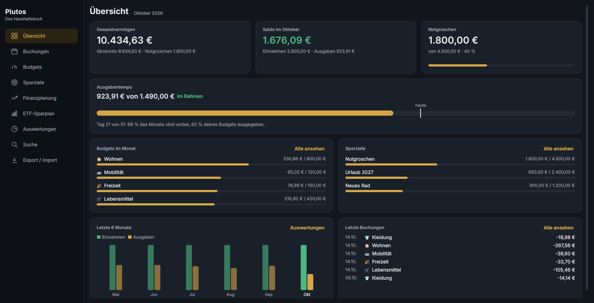
</p>

Plutos ist ein Haushaltsbuch für den Desktop, benannt nach dem griechischen
Gott des Reichtums. Es führt Buchungen wie ein echtes Kontobuch – mit
wiederkehrenden Einträgen, die wirklich wiederkehren, deutscher
Abgeltungsteuer samt Vorabpauschale und einer Finanzplanung, die deinen
tatsächlichen Kontostand kennt.

Plutos ist aus einem einfachen Kalender-Skript für Linux Mint gewachsen und
wurde Stück für Stück ausgebaut – jede Funktion entstand, weil sie im echten
Gebrauch fehlte. Es gibt **zwei unabhängige Oberflächen**, die sich dieselbe
Datenbank-Logik teilen:

| Ordner | Oberfläche | Plattformen |
|---|---|---|
| [`gtk/`](gtk/) | GTK3 | Linux (nativ für Linux Mint/Cinnamon) |
| [`qt/`](qt/) | Qt / PySide6 | macOS, Windows, Linux |

## Funktionen

- **Buchungen** in Monats-, Wochen- und Jahresansicht; Doppelklick auf einen
  Tag legt direkt eine Buchung mit diesem Datum an
- **Wiederkehrende Buchungen**, die unbegrenzt weiterlaufen und sich
  nachträglich bearbeiten lassen – wahlweise nur für die Zukunft oder
  rückwirkend
- **Budgets** pro Kategorie mit Fortschrittsbalken; ein Budget gilt ab dem Monat, für den
  es gesetzt wird, automatisch weiter (↺ = übernommen), bis man es ändert oder beendet –
  frühere Monate bleiben unverändert
- **Sparziele** mit manuell einstellbarer Priorität
- **Finanzplanung**: Kontostand (Startguthaben + Buchungen seitdem),
  Notgroschen-Berechnung aus den laufenden Fixkosten und eine transparente
  Faustregel-Empfehlung zur Aufteilung auf Notgroschen, Sparziele und
  ETF-Sparplan – optional mit Risikoprofil und Anlagehorizont
- **ETF-Sparplan-Rechner** mit steigender Sparrate, deutscher
  Kapitalertragsteuer (Teilfreistellung, Soli, Sparerpauschbetrag) und
  wahlweise jährlicher Vorabpauschale-Simulation, plus Vergleichsdiagramm
  gespeicherter Pläne
- **Auswertungen**: Kreisdiagramm, Trend über mehrere Monate,
  Sankey-Geldfluss-Diagramm und ein **Kategorienvergleich** (Monat gegen
  Vormonat mit Differenz in € und %, Jahresverlauf je Kategorie mit
  Durchschnittslinie)
- **Kategorien** mit eigenem Icon, **CSV-/JSON-Export und -Import** – der
  CSV-Import erkennt Bank-Spalten, schlägt Kategorien aus dem
  Buchungstext vor und legt bereits vorhandene Buchungen nicht doppelt an
- **Suche und Filter** über alle Buchungen: Freitext, Art, Kategorie,
  Zeitraum und Betragsspanne, mit Summenzeile – ein Doppelklick öffnet die
  Buchung zum Bearbeiten
- **Schnellbuchungs-Vorlagen** („Tanken 60 €“ per Klick) und **Rückgängig**
  (Strg+Z) für die zuletzt gelöschte Buchung
- **Budget-Warnungen**: Farbmarkierung ab 80 % und 100 % im Budgets-Tab,
  dazu ein Hinweis, sobald eine neue Ausgabe eine dieser Schwellen überschreitet
- **Jahresübersicht mit Vorjahresvergleich**: Einnahmen, Ausgaben und
  Sparquote je Monat, dem gleichen Monat des Vorjahres gegenübergestellt
- **ETF-Szenarien**: pessimistisch / erwartet / optimistisch nebeneinander,
  inklusive Kosten-Spread, Steuern und inflationsbereinigtem Endwert
  (Simulation, keine Anlageempfehlung)
- **Notgroschen als Unterkonto** (optional): Girokonto und Notgroschen werden
  getrennt ausgewiesen, ohne dass gebuchte Sparbeiträge doppelt zählen
- **Budgets im Jahr**: je Kategorie und Monat, um wie viel man über oder unter dem
  Budget lag, dazu wie oft und in welcher Summe – nur abgeschlossene Monate zählen
- **Tags** an Buchungen („Urlaub“, „Geschenk“ …): in der Suche auffindbar, in den
  Auswertungen nach Tag aufsummiert, im CSV-Export/-Import enthalten
- **Monatsabschluss**: Rückblick auf den Vormonat auf der Übersichtsseite (Gespart,
  Sparquote, Vergleich zum Vormonat, größte Ausgabe, eingehaltene Budgets), bis man ihn ausblendet
- **Modernes Design**: Seitenleiste mit Icons, eine **Übersichtsseite**
  (Gesamtvermögen, Monatssaldo, Notgroschen, Ausgabentempo, Budgets, Sparziele,
  Trend der letzten Monate, letzte Buchungen) sowie ein **helles und dunkles
  Design** – folgt dem System oder wird im Tab „Export / Import“ gewählt
  (GTK: wirkt sofort, Qt: nach einem Neustart). Qt- und GTK-Version sehen
  dadurch gleich aus.
- **Deutsch und Englisch**: Sprache im Tab „Export / Import“ wählbar
  (Neustart nötig); alle Beschriftungen, Hinweise und Meldungen sind übersetzt.
  Eigene Kategorienamen und die beim ersten Start angelegten Standardkategorien
  bleiben, wie sie in der Datenbank stehen.
- **Automatische Backups**: täglich eine Kopie der Datenbank (die letzten
  14 bleiben erhalten), zusätzlich „Datenbank jetzt sichern“ per Klick
- **„?“-Hilfe-Buttons** neben allen erklärungsbedürftigen Eingabefeldern

## Fertige Programmpakete

Unter [Releases](../../releases) liegen – sobald ein Release veröffentlicht ist –
fertige Pakete der Qt-Version, ganz ohne Python-Installation:

| System | Datei |
|---|---|
| Linux | `Plutos-<Version>-x86_64.AppImage` (ausführbar machen, doppelklicken) |
| Linux (GTK, nativ) | `Plutos-<Version>-linux-gtk.zip` – entpacken, `install.sh` ausführen (benötigt die GTK3-Pakete des Systems, bei Linux Mint schon vorhanden) |
| macOS (Apple Silicon) | `Plutos-<Version>-macOS-arm64.dmg` |
| Windows | `Plutos-<Version>-Setup.exe` oder `…-windows-portable.zip` |

Die Programme sind nicht signiert, daher warnen macOS und Windows beim ersten Start:
unter macOS Rechtsklick auf die App → „Öffnen“, unter Windows „Weitere Informationen“
→ „Trotzdem ausführen“. Deine Daten liegen weiterhin im Benutzerordner und bleiben
bei Updates erhalten.

**Selbst bauen:** Die Pakete entstehen automatisch per GitHub Actions
(`.github/workflows/release.yml`), sobald ein Tag wie `v1.1.0` gepusht wird. Lokal:
`pip install -r qt/requirements.txt pyinstaller`, dann
`pyinstaller packaging/plutos.spec --noconfirm` (Ergebnis in `dist/Plutos/`) und unter
Linux zusätzlich `bash packaging/build-appimage.sh <Version>`.

## Screenshots

| | |
|---|---|
|  | 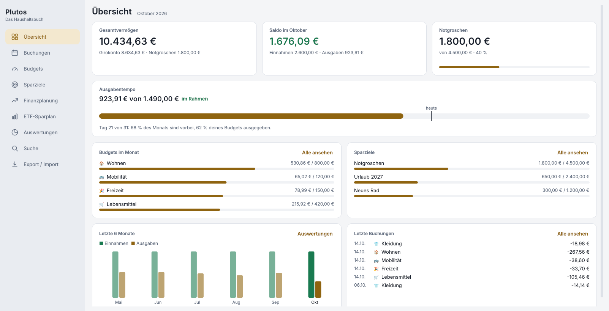 |
| 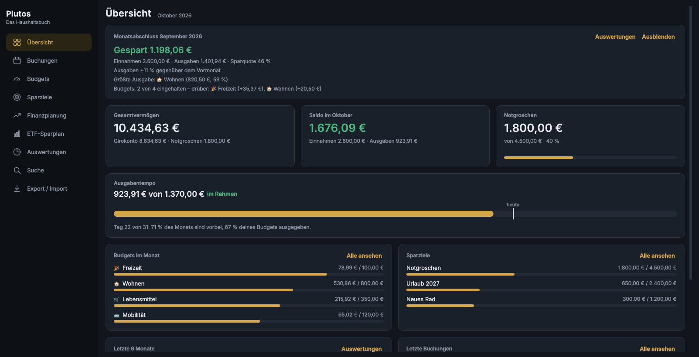 | 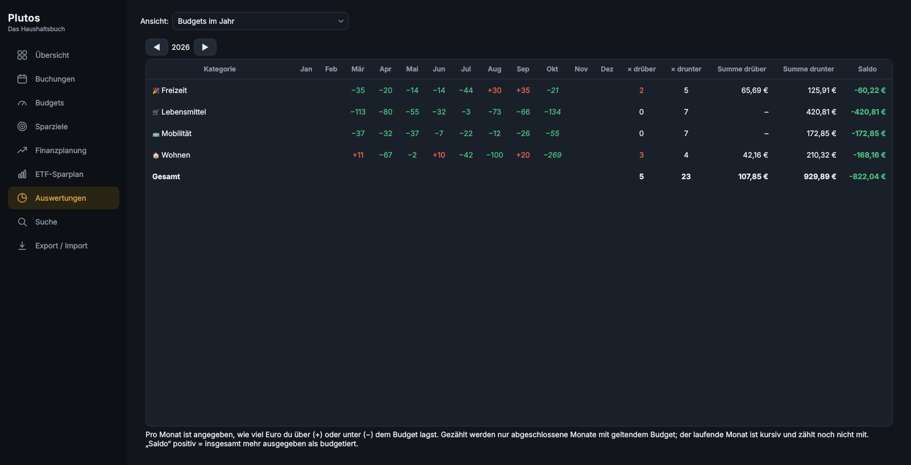 |

| | |
|---|---|
| 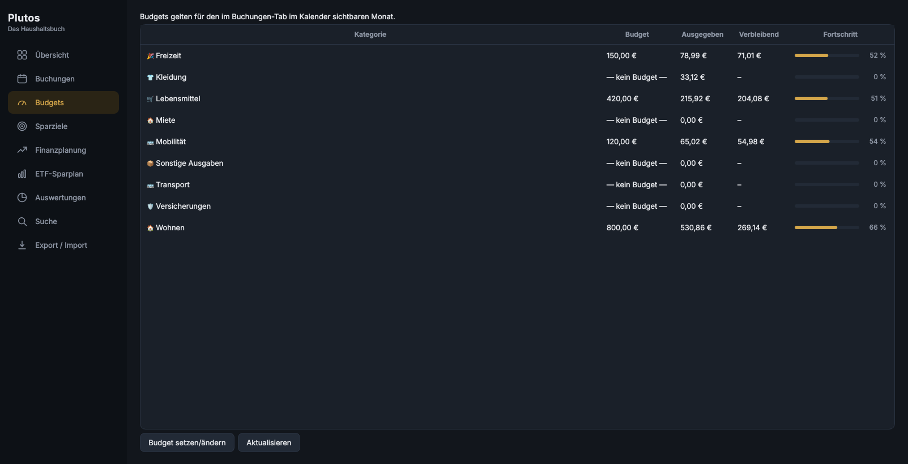 | 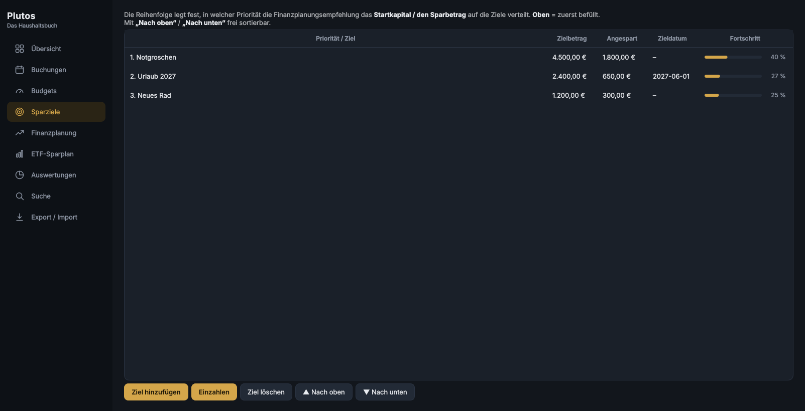 |
| 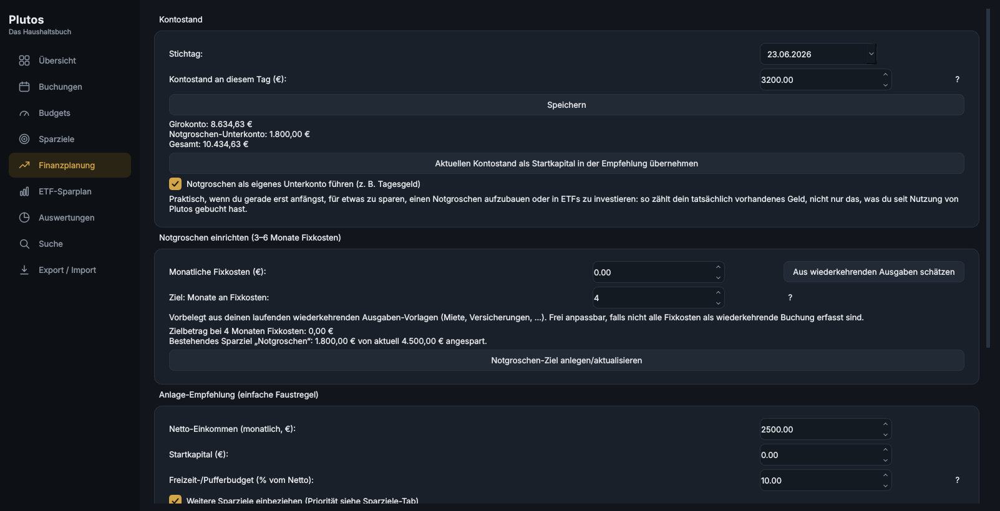 | 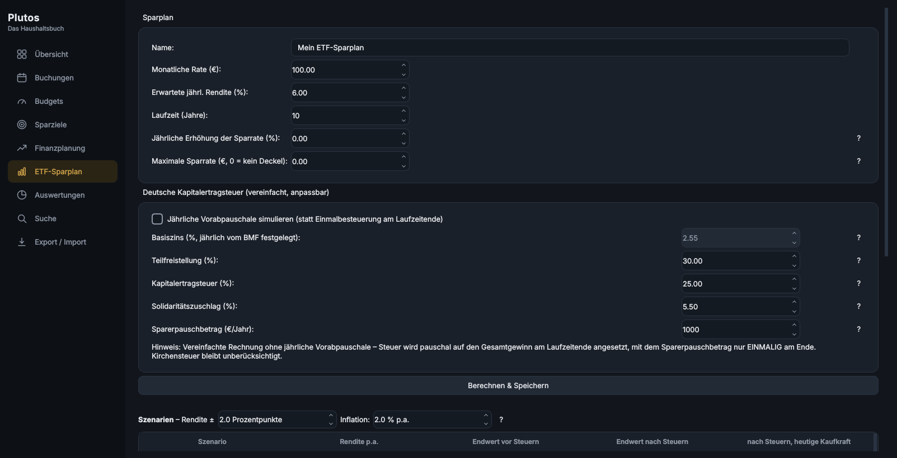 |

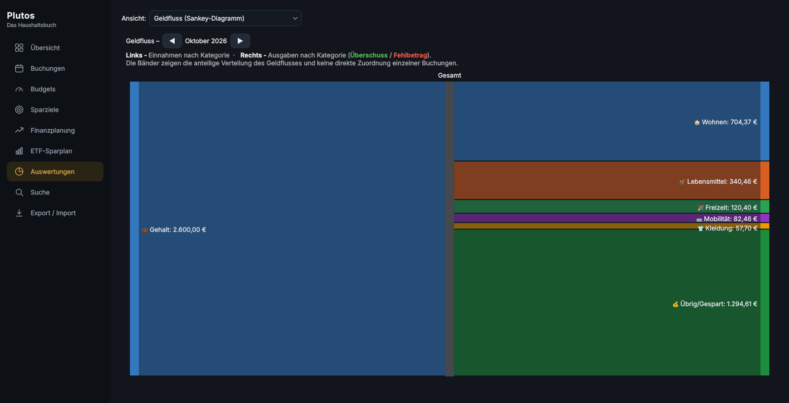

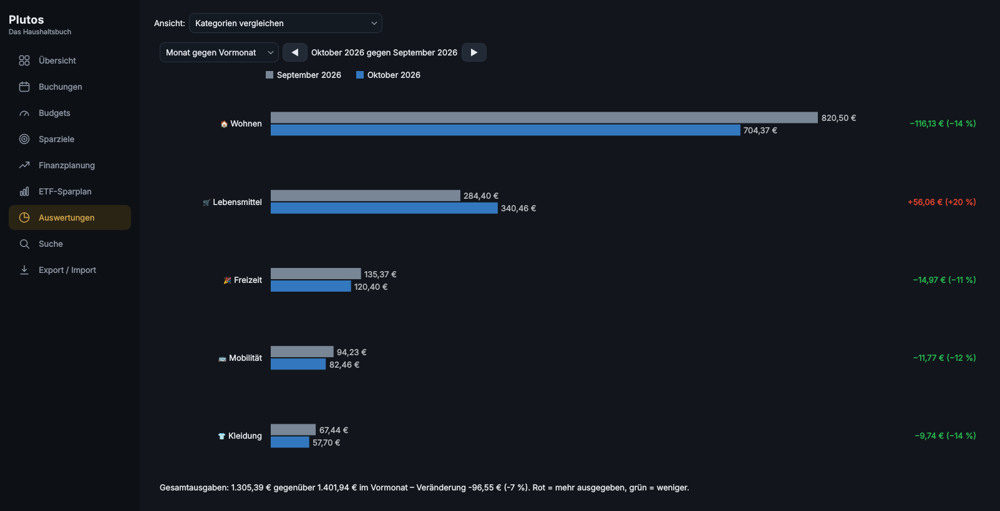

## GTK und Qt im Vergleich

Beide Oberflächen zeigen dieselben Daten – links GTK (Linux), rechts Qt
(macOS, Windows, Linux):

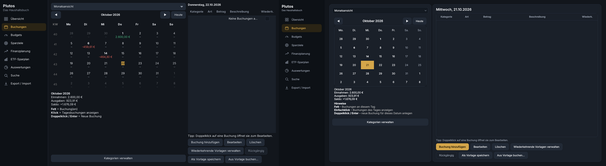

## Installation

Jede Version bringt eigene Installer-Skripte mit, die die Programmdateien an
einen festen Ort kopieren und einen Starter bzw. Menüeintrag anlegen. Die
Datenbank liegt immer getrennt von den Programmdateien und bleibt bei
Updates und Neuinstallationen unberührt.

**Linux (GTK):** siehe [`gtk/README.md`](gtk/README.md)

```bash
cd gtk
bash install.sh
```

**macOS / Windows / Linux (Qt):** siehe [`qt/README.md`](qt/README.md)

```bash
cd qt
bash install-macos.sh      # macOS
bash install-linux.sh      # Linux
# Windows: install-windows.bat per Doppelklick
```

Eine ausführliche Problembehandlung für alle Plattformen steht in der
[`qt/README.md`](qt/README.md).

## Datenspeicherort

| Plattform | Datenordner |
|---|---|
| Linux | `~/.local/share/plutos/` |
| macOS | `~/Library/Application Support/Plutos/` |
| Windows | `%APPDATA%\Plutos\` |

## Hinweis

Plutos ist ein privates Projekt und **keine Finanzberatung**. Die Steuer- und
Finanzplanungs-Rechner sind vereinfachte Modellrechnungen zur groben
Orientierung. Für verbindliche Entscheidungen bitte eine unabhängige Finanz-
oder Steuerberatung hinzuziehen.

Entwickelt iterativ im Gespräch mit [Claude](https://claude.ai) (Anthropic).
Die Berechnungslogik ist durch automatisierte Funktionstests abgedeckt; alle
Screenshots sind echte Aufnahmen der laufenden App.

## Tests

Die gemeinsame Datenlogik (`gtk/db.py` und `qt/db.py`) wird mit `pytest`
getestet:

```bash
pip install pytest
python -m pytest tests -q
```

## Lizenz

Veröffentlicht unter der [MIT-Lizenz](LICENSE).
